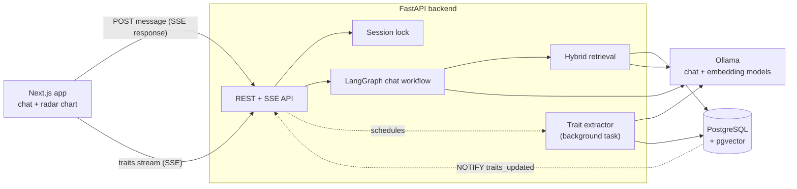
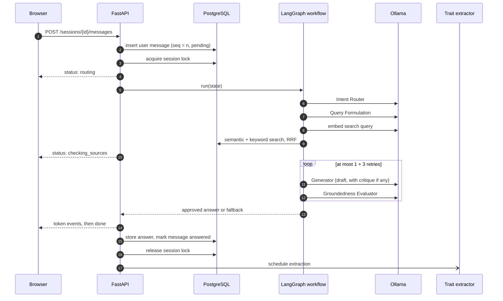
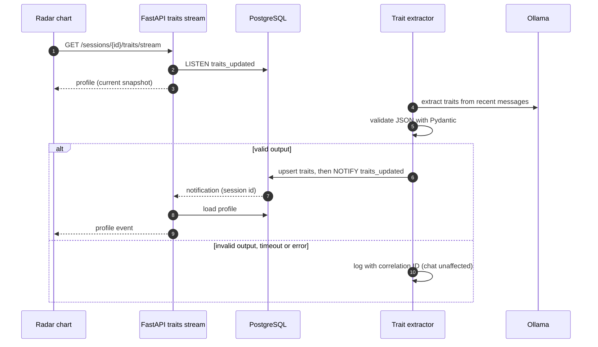
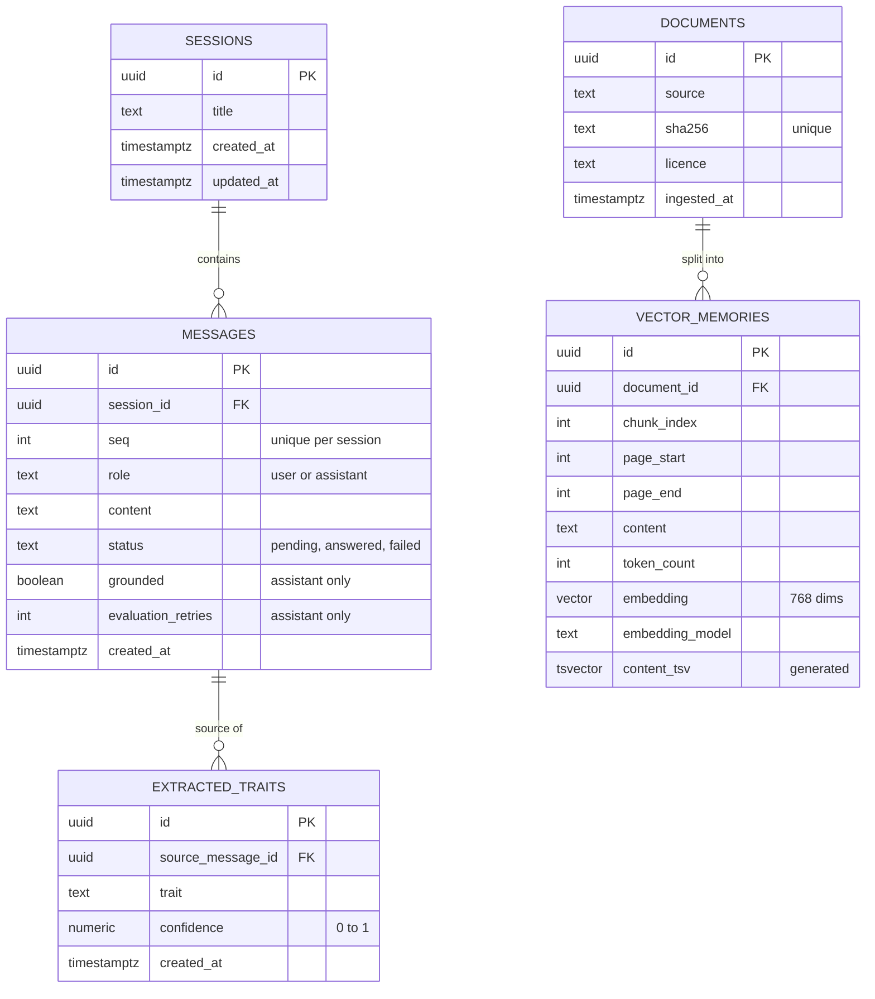
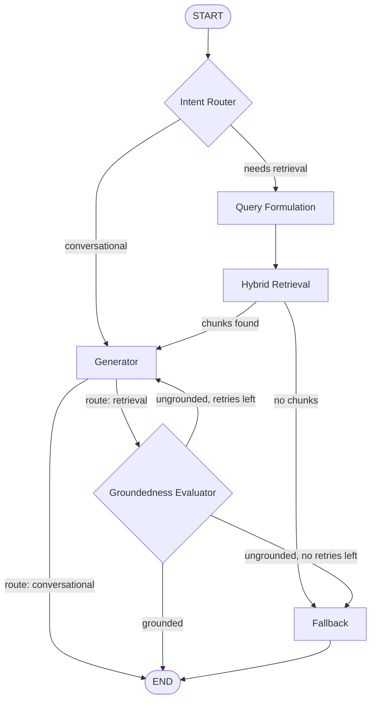

# Technical Design Document: Cognitive Profiler Engine

| | |
|---|---|
| Document | TDD v1 (deliverable D1) |
| Project | BGP-SBX-A-01, Baagupadu Intern Sandbox Programme |
| Status | Draft for review |
| Date | 13 Oct 2026 |
| Author | [Your name] |

Decisions marked **Proposed** are waiting for reviewer feedback. Open questions are listed in section 15. This document is updated at each milestone and finalised in Week 8.

---

## 1. Introduction

### 1.1 Purpose

This document describes the architecture, data model, interfaces and key decisions of the Cognitive Profiler Engine. Version 1 is written at the end of Week 1, before most of the implementation.

### 1.2 What the system does

A user chats with an assistant about daily habits. Answers are grounded in a reference corpus of about 50 pages on habit psychology. While the conversation continues, a background process extracts personality traits (for example "Highly Organized") with confidence scores, and these appear on a live radar chart next to the chat.

Trait outputs are for engineering demonstration only and are not a psychological assessment.

### 1.3 The four engineering problems

| Problem | Design response | Section |
|---|---|---|
| Grounding | Hybrid retrieval, plus a separate Groundedness Evaluator with bounded retries | 6, 7 |
| Latency isolation | Trait extraction runs as a background task, outside the request path | 8 |
| State consistency | Per-session sequence numbers and a session lock | 9 |
| Live visibility | Response streaming over SSE; trait updates pushed to the dashboard over SSE | 10 |

### 1.4 Scope

In scope: relational schema and migrations, corpus ingestion, hybrid retrieval and its evaluation, the LangGraph workflow, asynchronous trait extraction, the streaming UI with a live radar chart, dataset curation and local model serving.

Out of scope: authentication and multi-tenancy, cloud deployment, training or fine-tuning model weights, mobile apps, and any production code, data or infrastructure.

---

## 2. Requirements traceability

| Requirement | Design | Verification |
|---|---|---|
| CPE-FR-01 Schema, FKs, migrations | §4 | Migration up/down test in CI; cascade-delete integration test |
| CPE-FR-02 Ingestion pipeline | §5 | Chunker unit tests; chunking report (D3) |
| CPE-FR-03 Hybrid retrieval | §6 | RRF unit tests; retrieval integration tests |
| CPE-FR-04 Retrieval evaluation | §6.4 | Retrieval evaluation report (D4) |
| CPE-FR-05 to 09 Workflow | §7 | Workflow tests with a scripted fake LLM; evaluator test report (D5) |
| CPE-FR-10 Trait extractor | §8 | Failure-isolation tests |
| CPE-FR-11 Concurrency | §9 | Concurrency tests (D6) |
| CPE-FR-12 to 14 Interface | §10 | Demo; frontend tests (D7) |
| CPE-FR-15, 16 Model customisation | §11 | JSONL schema validation; reproducible `ollama create` (D8) |
| NFR-01 Reliability | §12.4 | Failure-path tests |
| NFR-02 Performance | §12.1 | Latency report |
| NFR-03 Security | §7.5, §12.2 | Input validation tests |
| NFR-04 Data protection | §5, §11 | Synthetic data only; review checklist |
| NFR-05, 06 Maintainability, testability | §13 | CI: Ruff, mypy, pytest, coverage at least 70% |
| NFR-07 Observability | §12.3 | Implemented in Week 1; logging tests |
| NFR-08 Reproducibility | §3.3 | Clean-checkout run using the README |

---

## 3. Architecture

### 3.1 Component view



### 3.2 Backend modules

```
backend/app/
  main.py            app factory, middleware, routers           (Week 1)
  config.py          settings from environment variables        (Week 1)
  observability.py   JSON logging, correlation IDs              (Week 1)
  api/               HTTP + SSE endpoints; validation only       (Week 1: health)
  db/                engine, ORM models, repositories           (Week 1: engine)
  ingestion/         extract, chunk, embed, store               (M1)
  retrieval/         semantic, keyword, fusion, evaluation      (M2)
  workflow/          LangGraph state, nodes, graph wiring       (M2)
  extraction/        trait extractor and its scheduler          (M3)
  llm/               LLM client interface, Ollama client, fakes (M2)
```

Each module has one responsibility. API handlers contain no business logic. Workflow nodes and the extractor depend on an `LLMClient` interface (a Python `Protocol`), not on Ollama directly. Tests can therefore use scripted or recorded responses (NFR-06).

### 3.3 Runtime

Docker Compose runs:
- `db`: `pgvector/pgvector:pg16`
- `backend`: FastAPI under uvicorn
- `frontend`: added in M3

By default Ollama runs on the host, which gives it direct GPU access and keeps downloaded models across rebuilds. The backend reaches it at `OLLAMA_BASE_URL` (from a container, `http://host.docker.internal:11434`). Whether to also run Ollama as a Compose service will be decided by an ADR in M4.

### 3.4 Key sequences

**A chat message on the retrieval route**, including the evaluation loop:



**Trait extraction updating the dashboard**, off the request path:



---

## 4. Data model

### 4.1 ERD



### 4.2 Tables and constraints

- **sessions**: one row per conversation.
- **messages**:
  - `session_id` references `sessions` with `ON DELETE CASCADE`.
  - `UNIQUE (session_id, seq)` defines the order inside a session (§9).
  - `CHECK` constraints on `role` and `status`.
  - User messages carry `status`. Assistant messages carry `grounded` (null on the conversational route) and `evaluation_retries`.
- **extracted_traits**:
  - `source_message_id` references the user message that triggered the extraction, with `ON DELETE CASCADE`. Deleting a session therefore deletes its messages and their traits.
  - `CHECK (confidence BETWEEN 0 AND 1)`.
  - `UNIQUE (source_message_id, trait)` makes re-running an extraction idempotent.
  - The session is reached through the message, which keeps the table normalised. A denormalised `session_id` column could be added later if profile queries need it; at this data size they don't.
- **documents**: one row per corpus file. `sha256` is unique, so ingesting the same file twice does nothing. This table is an addition to the four tables named in the brief; it avoids repeating source metadata on every chunk.
- **vector_memories**: one row per corpus chunk.
  - `document_id` references `documents` with `ON DELETE CASCADE`.
  - `UNIQUE (document_id, chunk_index)`.
  - `content_tsv` is `GENERATED ALWAYS AS (to_tsvector('english', content)) STORED`.
  - Indexes: HNSW on `embedding` (`vector_cosine_ops`) and GIN on `content_tsv`.
  - Whether this table should also hold conversation memories is open question 4.

### 4.3 Migrations

- Alembic with an async `env.py`. There is one revision per schema change, and applied revisions are never edited.
- The first revision creates the `vector` extension, all tables, constraints and indexes.
- A constraint naming convention on the SQLAlchemy `MetaData` keeps generated migrations deterministic.
- CI runs `upgrade head`, then `downgrade base`, then `upgrade head` against the pgvector service container.

---

## 5. Ingestion pipeline

1. **Extract**: read text page by page with `pypdf` (BSD licence). AGPL libraries such as PyMuPDF are avoided because this is proprietary code.
2. **Normalise**: repair hyphenation at line ends and collapse whitespace.
3. **Segment**: split into paragraphs (blank lines), then into sentences.
4. **Chunk**:
   - Pack whole paragraphs up to a target size. Split an over-long paragraph at sentence boundaries; never split inside a sentence.
   - Overlap: the last whole sentences of the previous chunk, up to the overlap budget, are repeated at the start of the next one.
   - A chunk records `page_start` and `page_end`, because it may span pages.
5. **Embed**: call the embedding model through the `LLMClient` interface in batches, and store the model name with each chunk.
6. **Store**: in one transaction per document. A changed file replaces its old chunks.

Initial parameters, all configurable. These are validated in the chunking report (D3) and the retrieval evaluation (D4):

| Parameter | Initial value | Reason |
|---|---|---|
| Target chunk size | ~300 tokens | Big enough to hold one idea with its context, small enough to keep embeddings specific |
| Maximum chunk size | 400 tokens | Top-5 results then use at most ~2,000 tokens of the small local model's context window |
| Overlap | ~50 tokens (whole sentences) | Keeps an idea that crosses a boundary findable from either chunk |
| Minimum chunk size | 50 tokens | A short tail is merged into the previous chunk |

Token counts use a simple approximation (words × 1.3). This is enough because the limits are far below the embedding model's maximum input.

---

## 6. Retrieval

### 6.1 Semantic search

```sql
SELECT id
FROM vector_memories
ORDER BY embedding <=> :query_embedding   -- cosine distance (pgvector)
LIMIT :candidates;
```

### 6.2 Keyword search

```sql
SELECT id, ts_rank_cd(content_tsv, query) AS rank
FROM vector_memories, websearch_to_tsquery('english', :query_text) AS query
WHERE content_tsv @@ query
ORDER BY rank DESC
LIMIT :candidates;
```

### 6.3 Fusion

Reciprocal Rank Fusion: `score(d) = Σ 1 / (k + rank_i(d))`, where the sum runs over both lists.

Default values (configurable): `k = 60`, 20 candidates from each list, `top_k = 5`. Ties are broken by semantic rank. The fusion is a pure function with unit tests. See [ADR-0002](adr/0002-hybrid-retrieval-fusion.md).

### 6.4 Evaluation (D4)

- Labelled set: `data/eval/retrieval_queries.jsonl`, with at least 20 queries. Each query lists its relevant passages as `{source, page, quote}`.
- A chunk counts as relevant if it contains the quoted passage. Labels therefore stay valid when the chunk size changes, which is needed to compare chunking settings.
- Query mix:
  - paraphrases, where semantic search should win
  - exact terms and names, where keyword search should win
  - mixed queries
- Metrics: recall@5 and MRR for semantic-only, keyword-only and hybrid retrieval, produced by `python -m app.retrieval.evaluate`.

---

## 7. Chat workflow (LangGraph)

### 7.1 State

```python
class ChatState(BaseModel):
    session_id: UUID
    messages: list[ChatMessage]  # history, oldest first
    route: Literal["retrieval", "conversational"] | None = None
    search_query: str | None = None
    retrieved_context: list[RetrievedChunk] = Field(default_factory=list)
    draft_answer: str | None = None
    critique: str | None = None
    retry_count: int = 0  # regenerations after a rejection
    status: Literal["running", "grounded", "conversational", "fallback", "failed"] = "running"
```

### 7.2 Graph



### 7.3 Nodes

| Node | Output | On failure |
|---|---|---|
| Intent Router | `route` (validated enum) | Default to `retrieval`, the safer path |
| Query Formulation | `search_query` | Use the raw user message |
| Hybrid Retrieval | `retrieved_context` (top-k) | Status `failed`; SSE `error` event |
| Generator | `draft_answer`, using context and any critique | Status `failed`; SSE `error` event |
| Groundedness Evaluator | `{grounded, unsupported_claims, critique}` (validated JSON) | Invalid output counts as a rejection (fail closed); if the model is unavailable, go to Fallback |
| Fallback | A fixed safe answer plus the sources consulted | — |

The evaluator is a separate LLM call with its own prompt. It never shares a call with the generator.

### 7.4 Bounded loop

- `MAX_RETRIES = 3` (configurable). A rejection increments `retry_count`, so there are at most 4 generator calls per message.
- After the last rejection the Fallback node answers: "I couldn't find enough support in the reference material to answer that confidently." It lists the sources it consulted. The rejected draft is never shown.
- Second guard: the graph is invoked with `recursion_limit = 25`. The longest legitimate path is 12 steps: router, query formulation, retrieval, 4 × (generate + evaluate), fallback. If `GraphRecursionError` is raised, it is caught, logged and turned into the fallback answer.

### 7.5 Prompt-injection awareness (NFR-03)

- User text and retrieved text are placed inside clearly delimited blocks. System prompts state that anything inside those blocks is data, not instructions.
- The router, evaluator and extractor outputs are parsed with Pydantic. Injected text can therefore only produce allowed values; it cannot change the control flow in other ways.
- The model has no tools and cannot execute code.

### 7.6 Streaming

**Proposed:** evaluate first, then stream. See [ADR-0004](adr/0004-streaming-and-groundedness-evaluation.md).

---

## 8. Trait extraction

- **Trigger:** after the assistant answer is stored, the API schedules extraction for `(session_id, user_message_id)`. The user's response is never delayed.
- **Input:** the last N user messages of the session.
- **Output:** validated JSON:

  ```json
  {"traits": [{"trait": "Highly Organized", "confidence": 0.82}]}
  ```

  Each item must use a trait from the configured vocabulary and have a confidence between 0 and 1. Invalid items are dropped and logged.
- **Vocabulary (Proposed):** the radar chart needs fixed axes, so the list is configured rather than free text. The starting list is Introverted, Highly Organized, Disciplined, Spontaneous, Health-Conscious and Curious.
- **Profile value:** the most recent confidence for each trait. Each extraction looks at the recent conversation as a whole, so the latest value is the best estimate.
- **Execution:** an in-process asyncio task with its own database session, a timeout and a catch-all error handler. See [ADR-0006](adr/0006-background-trait-extraction.md).
- **Isolation:**
  - Every exception is logged with the request's correlation ID and never reaches the chat.
  - The extractor does not take the session lock.
  - Writes are idempotent.
  - After commit it runs `NOTIFY traits_updated, '<session_id>'`.

---

## 9. Concurrency and ordering

**Defined behaviour:** within one session, user messages are answered one at a time, in the order they arrived. Different sessions run in parallel.

**Mechanism** (Proposed; see [ADR-0003](adr/0003-session-concurrency-control.md)):

1. In one short transaction:
   - lock the session row (`SELECT … FOR UPDATE`)
   - assign `seq = max(seq) + 1`
   - insert the user message with `status = pending`, then commit
2. Acquire a PostgreSQL advisory lock keyed by the session, with a bounded wait (default 120 s). On timeout:
   - send an SSE `error` event with code `session_busy`
   - mark the message `failed`
3. While holding the lock, check that no earlier message is still `pending`. Lock waiters may be woken out of arrival order; if this request isn't next, it releases the lock, waits briefly and retries.
4. Load the history, which now includes the answers to earlier messages. Then run the workflow, store the answer, mark the message `answered` and release the lock.

**Scenario: three messages A, B and C arrive before A's answer is complete.**
- They get `seq` 1, 2 and 3.
- B and C send a `status: queued` event while they wait.
- B runs after A is answered, with A's answer in its history. C runs after B.

Advisory locks taken at session level are released automatically when the connection closes, so a crashed request cannot leave a session locked.

**Tests:**
- Three concurrent requests against a fake LLM that records call order: assert the order and the history each call received.
- Lock timeout.
- Failure in the middle of the workflow releases the lock.

---

## 10. API and interface

| Method and path | Purpose |
|---|---|
| `GET /health` | Liveness (implemented) |
| `GET /health/ready` | Database + pgvector readiness; 503 if not ready (implemented) |
| `POST /sessions` | Create a session, returns `201 {id}` |
| `GET /sessions/{id}` | Session with its messages |
| `DELETE /sessions/{id}` | Delete; cascades to messages and traits |
| `POST /sessions/{id}/messages` | Send a message; the response is an SSE stream |
| `GET /sessions/{id}/traits` | Current profile |
| `GET /sessions/{id}/traits/stream` | SSE stream of profile updates |

SSE events on the message stream:

```
event: status
data: {"stage": "retrieving"}

event: token
data: {"text": "Morning "}

event: done
data: {"message_id": "…", "grounded": true, "sources": [{"source": "habits.pdf", "page": 12}]}

event: error
data: {"code": "session_busy", "message": "…"}
```

- **Validation:** Pydantic request models check that `content` is 1–4,000 characters and that path IDs are UUIDs. CORS is limited to the frontend origin. The OpenAPI specification is generated by FastAPI at `/openapi.json`.
- **Frontend (M3):**
  - Next.js App Router, TypeScript in strict mode, ESLint.
  - The chat stream is read with `fetch` and a `ReadableStream`, because the browser's `EventSource` cannot send POST requests.
  - Traits use `EventSource`.
  - The radar chart uses Recharts (MIT licence). See [ADR-0005](adr/0005-live-dashboard-updates.md).

---

## 11. Model customisation and serving

- **Dataset curation (CPE-FR-15):**
  - A script runs synthetic personas through the real workflow to fill the sandbox database. Only synthetic data is used (NFR-04).
  - Draft selection criteria:
    - at least 4 turns
    - every retrieval answer grounded
    - no fallback or failed turns
    - no near-duplicate openings
    - length within bounds
  - Export: `{"messages": [{"role": …, "content": …}, …]}` per line (JSONL), validated against a Pydantic schema.
- **Serving (CPE-FR-16):**
  - Take a quantized GGUF model from Hugging Face. Record its licence and SHA-256 in `ml/README.md`.
  - Write a `Modelfile` with `FROM`, `SYSTEM`, `PARAMETER temperature` and `PARAMETER stop`, then build it with `ollama create sandbox_model -f ml/Modelfile`.
  - The model is chosen with the `CHAT_MODEL` environment variable.
  - Weights are never committed.
  - The model size is chosen after the hardware check (ADR in M4).

---

## 12. Non-functional design

### 12.1 Performance (NFR-02)

- **Measured:**
  - time to first token (request received to first `token` event)
  - end-to-end latency (to the `done` event)
  - per-node durations, taken from the logs
- **Method:** a script runs a fixed query set and reports p50 and p95 separately for the conversational and retrieval routes.
- **Targets:** proposed after a first measurement on the actual hardware, then agreed with the reviewer (open question 6).

### 12.2 Security (NFR-03)

- Pydantic validation on every endpoint and on configuration. Week 1 already rejects bad settings and malformed correlation IDs.
- Prompt-injection measures as described in §7.5.
- Secrets come only from environment variables; the repository holds `.env.example` with placeholders.
- No real personal data (NFR-04).

### 12.3 Observability (NFR-07)

- **Implemented in Week 1:**
  - JSON log lines
  - an `X-Correlation-ID` per request, which reuses a well-formed incoming ID and otherwise generates one
  - one request log line with method, path, status and duration
- **Planned:**
  - `node_started` and `node_finished` events with their duration
  - `evaluation_rejected` events with `retry_count`
  - the correlation ID passed on to background extraction

### 12.4 Failure behaviour (NFR-01)

| Failure | Behaviour | Test |
|---|---|---|
| Database unreachable | `/health/ready` returns 503; requests return 503 | Unit test (implemented) |
| Ollama down during generation | SSE `error` event; message marked `failed` | Workflow test |
| Evaluator returns invalid JSON | Counted as a rejection | Workflow test |
| Evaluator unavailable | Fallback answer | Workflow test |
| Evaluator rejects 3 retries in a row | Fallback answer; status `fallback` | Workflow test |
| Recursion limit reached | Fallback answer; error logged | Workflow test |
| Trait extractor error or timeout | Logged; chat unaffected; profile unchanged | Extractor test |
| Session lock wait timeout | SSE `session_busy`; message `failed` | Concurrency test |

### 12.5 Reproducibility (NFR-08)

`docker compose up` from a clean checkout, using `.env.example` as the template. Image tags are pinned, and the README lists the steps to get the model.

---

## 13. Testing strategy

| Level | Covers | How |
|---|---|---|
| Unit | Pure logic: RRF, chunker, routing conditions, schemas, configuration | pytest; no I/O |
| Integration | Migrations, cascades, retrieval SQL, readiness | pytest against the pgvector container (Compose locally, a service container in CI) |
| Workflow | Grounded on the first try; rejected then grounded; rejected 3 times then fallback; invalid evaluator JSON; LLM timeout | Scripted `FakeLLM`; recorded fixtures for prompts |
| Concurrency | Three concurrent messages; lock timeout | `asyncio.gather` against the API |
| Extractor | Invalid JSON, timeout, database error; chat unaffected | Fake LLM plus fault injection |

LLM calls in automated tests are always mocked or replayed, which makes the tests deterministic. For manual runs, temperature and seed are fixed.

CI runs on every pull request:
- Ruff lint and format check
- mypy in strict mode
- pytest, including integration tests against a pgvector service container, with coverage of at least 70%
- a Docker image build

---

## 14. Repository and delivery

- **Layout:** follows the brief (`backend/`, `frontend/`, `ml/`, `data/`, `docs/`, `tests/`, `.github/`).
- **Protected `main`:** every change goes through an issue, a branch named `type/ISSUE-ID-description`, Conventional Commits, and a pull request with a template. Merging needs one approval and green CI, and uses squash merge.
- **Tracking:** issues are tracked on the project board with milestones M1–M4 and priority labels. See [PROJECT_PLAN.md](PROJECT_PLAN.md).

---

## 15. Risks and open questions

### Open questions

1. **Repository visibility:** the repository is currently public, but the brief is confidential. (Asked.)
2. **Working environment:** the email says personal devices must not be used. (Asked.)
3. **Corpus delivery:** when the corpus arrives decides when ingestion can start. (Asked.)
4. **VectorMemories scope:** corpus chunks only, or also memories from conversations?
5. **Streaming vs. evaluation:** see ADR-0004.
6. **Performance targets** (NFR-02).
7. **Trait vocabulary** for the radar chart axes.
8. **Hardware** available for local models.

### Risks

| Risk | Mitigation |
|---|---|
| LLM output is non-deterministic | Fixed temperature and seed; mocked or replayed responses in tests |
| Local hardware is slow, and up to 4 generations per message make it worse | Small quantized model; measure early; make `MAX_RETRIES` configurable; ADR on model size |
| Scope grows beyond 8 weeks | Must items first; Could item (FR-17) only at the end; raise changes in the weekly review |
| Corpus or model licensing | Use only the supplied corpus; record every licence |
| Corpus arrives late | Build ingestion against a small synthetic PDF first; flag it as a blocker |

---

## 16. ADR index

| ADR | Title | Status |
|---|---|---|
| [0001](adr/0001-record-architecture-decisions.md) | Record architecture decisions | Accepted |
| [0002](adr/0002-hybrid-retrieval-fusion.md) | Hybrid retrieval fusion with RRF | Proposed |
| [0003](adr/0003-session-concurrency-control.md) | Per-session ordering with an advisory lock | Proposed |
| [0004](adr/0004-streaming-and-groundedness-evaluation.md) | Streaming and groundedness evaluation | Proposed |
| [0005](adr/0005-live-dashboard-updates.md) | Live dashboard updates over SSE | Proposed |
| [0006](adr/0006-background-trait-extraction.md) | Background trait extraction in-process | Proposed |
| [0007](adr/0007-embedding-model.md) | Embedding model | Proposed |

## 17. Revision history

| Version | Date | Change |
|---|---|---|
| 1.0 | 13 Oct 2026 | First draft at the end of Week 1 |
